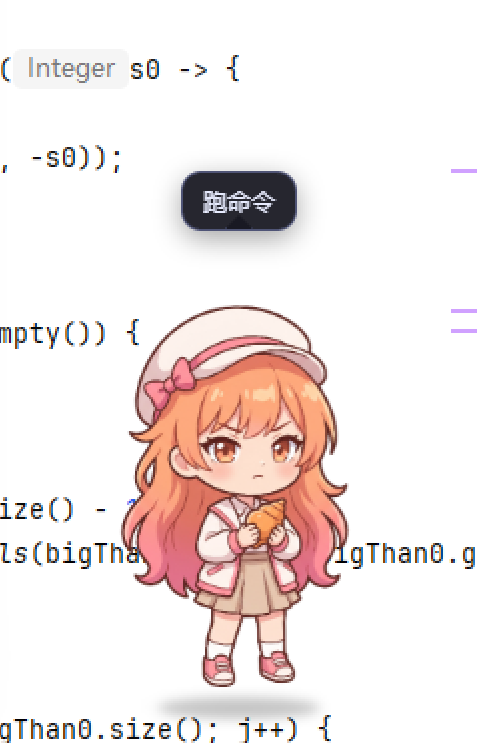
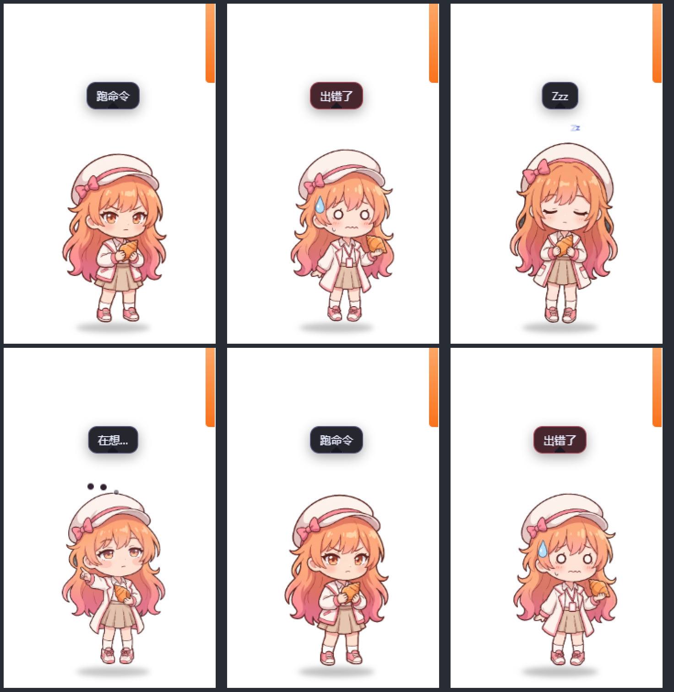

# MinimaxCode-Girl

一只住在桌面上的 MiniMax Code 桌宠。它只读地观察会话活动，然后换上对应的表情和动作。



## 它是什么

一只 Q 版二次元小人（白贝雷帽 + 粉蝴蝶结、橙粉渐变长发、琥珀眼、米色格纹裙，手里攥着一颗橙色海螺），
以**透明置顶窗口**的形式待在桌面角落。它读取 MiniMax Code 的会话记录，判断你现在处于哪种状态：

| 状态 | 触发条件 | 表现 |
| --- | --- | --- |
| `thinking` | 你刚发了指令 | 歪头思考，头顶冒三个点点 |
| `typing` / `working` | 模型在调工具 | 轻微点头干活，气泡显示工具名 |
| `permission` | **正在等你批准操作** | 摊开手掌作「请」的手势，琥珀色问号脉冲 |
| `happy` | 这一轮出完了最终答复 | 跳跃 + 金色星光，气泡「搞定！」 |
| `error` | 工具返回 `isError` | 抖动 + 红色感叹号 |
| `idle` / `sleeping` | 20 秒 / 150 秒无动静 | 呼吸起伏 / 慢呼吸 + 冒 z |

窗口下方还有一块**上下文用量面板**，实时显示当前上下文占用 / 上限、进度条和模型名
（≥60% 转黄、≥85% 转红）。

<p align="center">
  
</p>

## 快速开始

```powershell
git clone <this-repo>
cd MinimaxCode-Girl/deskpet
npm install

# 仓库不在运行时数据目录内部时，必须建这个文件（UTF-8 无 BOM）
# 内容：{ "dataDir": "D:/Data/.minimax/.minimax" }
notepad data-dir.local.json

npm start
```

托盘图标右键 → 退出。（直接关窗口不会退出，桌宠要常驻。）
拖动可以挪位置，松手会记住；右键可以「戳一下」/「回到右下角」/「退出」。

## 隐私边界

这个项目**只做两件事**：读会话目录、写一个记位置的小 json。

- 只读 `<dataDir>/v2/sessions/**/messages.jsonl`、`<dataDir>/config.yaml`、
  `<dataDir>/v2/observability/logs/runtime-*.log`，全部是**只读**打开
- 唯一写入是 Electron userData 目录下的 `pet-pos.json`（记窗口位置）
- **不读取你的文件内容做分析**——只看消息的 role、工具名和 token 用量
- **没有任何网络请求**，不碰 `auth.json` 里的任何凭据
- 仓库里不含任何密钥；生成参数文件中的临时图片 URL 已替换为占位符

## 项目结构

```
MinimaxCode-Girl/
├── deskpet/              Electron 桌宠本体
│   ├── main.js           窗口 / 托盘 / 位置记忆 / IPC
│   ├── watcher.js        会话状态探测（唯一的数据读取入口）
│   ├── pet.js            渲染与状态机
│   ├── index.html        DOM 分层 + CSS 动画
│   ├── preload.js        contextBridge 暴露的 API
│   └── assets/           7 张统一画布的透明立绘 PNG
├── pettools/             素材流水线：抠图 + 多姿态对齐
├── pet-flat-*.jpg        图像模型出的原始图（无 alpha）
└── gen-*.json            生成参数（图片 URL 已脱敏）
```

更细的实现说明见 [`deskpet/README.md`](deskpet/README.md)，里面有状态判定逻辑、
「等你批准」的启发式规则、上下文用量的取数方式、以及素材流水线的重跑命令。

## 已知边界

- **套餐类型 / 五小时限额 / 周限额没有做**。这三项在本地完全不落盘（数据目录按文件名扫过、
  78 张 sqlite 表全查过、运行时日志里也没有），只能读 `auth.json` 的登录凭据去请求服务端 API。
  为了保持零网络请求的安全边界，这里选择不做。
- **`permission` 状态是启发式的**。本地没有「等待批准」的标志位，
  只能靠「日志里最后一条权限判定停在 `ask`」+「会话自那时起没有新消息」来推断。
  在 `auto` 权限模式下 `ask` 会被同毫秒的 `bypass-allow allow` 覆盖，所以不会误报；
  但日志被关闭或轮转丢失时可能漏报。

## 路线图

- [x] 高清二维形象（替换最初的像素精灵）
- [x] 上下文用量面板
- [x] 「等你批准」状态
- [ ] **窗口应用化** — 从透明置顶窗改为常规窗口，带设置面板、开机自启、可配置模型/透明度/动画开关
- [ ] 插件化 — 见下

## 关于插件化

本仓库的桌宠**本体无法**作为 MiniMax Code 插件分发：插件包禁止携带原生二进制，
而 Electron 依赖实测 368.8 MB / 83 个文件（`electron.exe` 单文件 234.9 MB），
同时插件包还有单文件 ≤16 MiB 的硬限制。

可行的路线是**同仓库双产物**：

- `deskpet/` 作为独立桌面应用，通过 GitHub Releases 分发
- 新增 `plugin/minimax/` 子目录，放一个**纯 JS、无原生依赖**的 MCP server + Skill，
  把会话状态探测和上下文用量以工具的形式暴露给 Agent

MiniMax 插件市场接受 **ZIP 包或公开 GitHub 仓库**提交，GitHub 来源可以指定
branch / tag / commit / 插件子目录——所以子目录方案天然可行。

## License

MIT